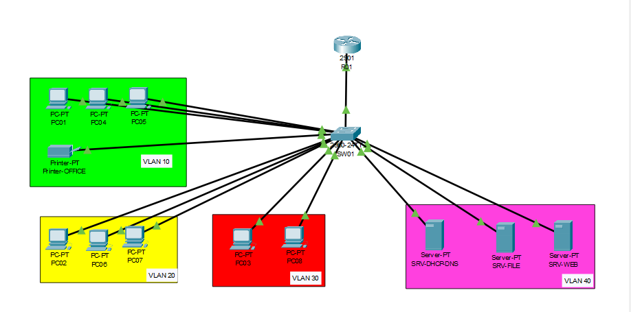

# Enterprise-Style Network Lab (Cisco Packet Tracer)

VLANs, 802.1Q trunk, router-on-a-stick, centralized DHCP/DNS/Web/File servers and a guest isolation ACL.

This lab started from a school exercise (one Cisco 2901 router, one Cisco 2960 switch, three Kubuntu clients). It is rebuilt and extended in Packet Tracer with more machines and a dedicated server VLAN so that it looks like a small company network.

## Objectives

- Segment a LAN into VLANs (office, technical, guests, servers)
- Carry the VLANs over an 802.1Q trunk
- Route between VLANs with router subinterfaces (router-on-a-stick)
- Give the switch a management IP address and a default gateway
- Centralize DHCP and DNS on a server and relay requests with `ip helper-address`
- Isolate the guest VLAN from the internal networks with an extended ACL
- Verify everything with `show` commands, `ping` and a web request

## Topology



```
                       +--------------------------------------+
                       |  Router Cisco 2901 (R-GROUP1)        |
                       |  Gi0/0 (no IP)                       |
                       |   +-- Gi0/0.10  10.110.1.1/26        |  VLAN 10 Office
                       |   +-- Gi0/0.20  10.110.1.65/26       |  VLAN 20 Technical
                       |   +-- Gi0/0.30  10.110.1.129/26      |  VLAN 30 Guests (ACL)
                       |   +-- Gi0/0.40  10.110.1.193/26      |  VLAN 40 Servers
                       +------------------+-------------------+
                                          |
                                          |  802.1Q trunk (switch Gi0/1)
                                          |
                       +------------------+-------------------+
                       |  Switch Cisco 2960 (SW-GROUP1)       |
                       |  Management IP 10.110.1.66 (VLAN 20) |
                       +---+------------+-----------+---------+---------+
                           |            |           |                   |
                      Fa0/1-10     Fa0/11-15    Fa0/16-20           Fa0/21-24
                      VLAN 10      VLAN 20      VLAN 30             VLAN 40
                      PC1 PC4 PC5  PC2 PC6 PC7  PC3 PC8             SRV-DHCP-DNS
                      Printer                                       SRV-WEB
                                                                    SRV-FILE
```

## Devices

| Device | Type | VLAN | Switch port | IP address |
|--------|------|------|-------------|------------|
| R-01 | Router 2901 | all | Gi0/1 (trunk) | see subinterfaces |
| SW-01 | Switch 2960 | 20 (management) | - | 10.110.1.66 (static) |
| PC1 | PC | 10 | Fa0/2 | 10.110.1.10 (static) |
| PC4 | PC | 10 | Fa0/3 | DHCP |
| PC5 | PC | 10 | Fa0/4 | DHCP |
| PRINTER-OFFICE | Printer | 10 | Fa0/5 | 10.110.1.5 (static) |
| PC2 | PC | 20 | Fa0/12 | 10.110.1.70 (static) |
| PC6 | PC | 20 | Fa0/13 | DHCP |
| PC7 | PC | 20 | Fa0/14 | DHCP |
| PC3 | PC | 30 | Fa0/16 | 10.110.1.135 (static) |
| PC8 | PC (guest) | 30 | Fa0/17 | DHCP |
| SRV-DHCP-DNS | Server | 40 | Fa0/21 | 10.110.1.194 (static) |
| SRV-WEB | Server | 40 | Fa0/22 | 10.110.1.195 (static) |
| SRV-FILE | Server | 40 | Fa0/23 | 10.110.1.196 (static) |

## IP Addressing Plan (/26)

Every subnet uses the mask 255.255.255.192. The four /26 blocks all come from the same 10.110.1.0/24 network.

| VLAN | Name | Subnet | Gateway (router) | Static range | DHCP range |
|------|------|--------|------------------|--------------|------------|
| 10 | OFFICE | 10.110.1.0/26 | 10.110.1.1 | .2 - .19 | .20 - .49 |
| 20 | TECHNICAL | 10.110.1.64/26 | 10.110.1.65 | .67 - .79 (switch: .66) | .80 - .109 |
| 30 | GUESTS | 10.110.1.128/26 | 10.110.1.129 | .130 - .139 | .140 - .169 |
| 40 | SERVERS | 10.110.1.192/26 | 10.110.1.193 | .194 - .254 | none |

## Step-by-Step Build

1. Place the devices in Packet Tracer and cable them according to the device table.
2. Configure the switch: VLANs, management IP, access ports, trunk.
3. Configure the router: physical interface, subinterfaces, DHCP relay, ACL.
4. Configure the servers: static IP, DHCP pools, DNS records, web and file services.
5. Configure the clients: static for PC1/PC2/PC3, DHCP for the others.
6. Run the tests and save the configurations.

## Switch Configuration (SW-GROUP1)

```
enable
configure terminal
hostname SW-01

! Create the VLANs
vlan 10
 name office
vlan 20
 name technical
vlan 30
 name guests
vlan 40
 name servers
exit

! Remove the default IP from VLAN 1
interface vlan 1
 no ip address
exit

! Management IP of the switch, in the technical VLAN
interface vlan 20
 ip address 10.110.1.66 255.255.255.192
 no shutdown
exit

! Default gateway of the switch
ip default-gateway 10.110.1.65

! Ports 1 to 10 -> VLAN 10 (office)
interface range fastEthernet 0/1 - 10
 switchport mode access
 switchport access vlan 10
 no shutdown
exit

! Ports 11 to 15 -> VLAN 20 (technical)
interface range fastEthernet 0/11 - 15
 switchport mode access
 switchport access vlan 20
 no shutdown
exit

! Ports 16 to 20 -> VLAN 30 (guests)
interface range fastEthernet 0/16 - 20
 switchport mode access
 switchport access vlan 30
 no shutdown
exit

! Ports 21 to 24 -> VLAN 40 (servers)
interface range fastEthernet 0/21 - 24
 switchport mode access
 switchport access vlan 40
 no shutdown
exit

! Trunk to the router, restricted to the VLANs in use
interface gigabitEthernet 0/1
 switchport mode trunk
 switchport trunk allowed vlan 10,20,30,40
 no shutdown
exit

end
copy running-config startup-config
```

Verification:

```
show vlan brief
show interfaces trunk
show ip interface brief
```

## Router Configuration (R-GROUP1)

```
enable
configure terminal
hostname R-01

! Physical interface: on, without IP address
interface gigabitEthernet 0/0
 no ip address
 no shutdown
exit

! VLAN 10 gateway (office), with DHCP relay to the server
interface gigabitEthernet 0/0.10
 encapsulation dot1Q 10
 ip address 10.110.1.1 255.255.255.192
 ip helper-address 10.110.1.194
 no shutdown
exit

! VLAN 20 gateway (technical), with DHCP relay
interface gigabitEthernet 0/0.20
 encapsulation dot1Q 20
 ip address 10.110.1.65 255.255.255.192
 ip helper-address 10.110.1.194
 no shutdown
exit

! VLAN 30 gateway (guests), with DHCP relay
interface gigabitEthernet 0/0.30
 encapsulation dot1Q 30
 ip address 10.110.1.129 255.255.255.192
 ip helper-address 10.110.1.194
 no shutdown
exit

! VLAN 40 gateway (servers)
interface gigabitEthernet 0/0.40
 encapsulation dot1Q 40
 ip address 10.110.1.193 255.255.255.192
 no shutdown
exit

! ACL: guests cannot reach the office, technical or server VLANs
ip access-list extended ACL_GUEST_ISOLATION
 deny ip 10.110.1.128 0.0.0.63 10.110.1.0 0.0.0.63
 deny ip 10.110.1.128 0.0.0.63 10.110.1.64 0.0.0.63
 deny ip 10.110.1.128 0.0.0.63 10.110.1.192 0.0.0.63
 permit ip any any
exit

! Apply the ACL inbound on the guest subinterface
interface gigabitEthernet 0/0.30
 ip access-group ACL_GUEST_ISOLATION in
exit

end
copy running-config startup-config
```

Verification:

```
show ip interface brief
show ip route
show access-lists
```

All subinterfaces must be `up / up`, each subnet must appear with the code `C` (directly connected), and the ACL counters show the matches on the deny and permit rules.

## Server Configuration

### SRV-DHCP-DNS (10.110.1.194)

Static IP: 10.110.1.194, mask 255.255.255.192, gateway 10.110.1.193, DNS 10.110.1.194.

DHCP service (one pool per VLAN):

| Pool | Default gateway | DNS server | Start IP | Mask | Max users |
|------|-----------------|------------|----------|------|-----------|
| OFFICE | 10.110.1.1 | 10.110.1.194 | 10.110.1.20 | 255.255.255.192 | 30 |
| TECHNICAL | 10.110.1.65 | 10.110.1.194 | 10.110.1.80 | 255.255.255.192 | 30 |
| GUESTS | 10.110.1.129 | 10.110.1.194 | 10.110.1.140 | 255.255.255.192 | 30 |

DNS service:

| Name | Type | Address |
|------|------|---------|
| web.company.local | A | 10.110.1.195 |
| files.company.local | A | 10.110.1.196 |

### SRV-WEB (10.110.1.195)

Static IP: 10.110.1.195, mask 255.255.255.192, gateway 10.110.1.193, DNS 10.110.1.194. HTTP service enabled.

### SRV-FILE (10.110.1.196)

Static IP: 10.110.1.196, mask 255.255.255.192, gateway 10.110.1.193, DNS 10.110.1.194. FTP service enabled.

## Client Configuration

### In Packet Tracer

- PC1, PC2, PC3: Desktop > IP Configuration > Static, with the values from the device table, the /26 mask, and the gateway of their VLAN.
- Other PCs: Desktop > IP Configuration > DHCP.

### On real hardware (Kubuntu, with `nmcli`)

Replace `eno1` with the name of the local network interface, and adapt the IP address to the machine (PC1 / PC2 / PC3).

```bash
# Create a dedicated static profile, without touching the original DHCP profile
nmcli connection add type ethernet ifname eno1 con-name BAIE ipv4.method manual ipv4.addresses 10.110.1.10/26 ipv4.gateway 10.110.1.1 ipv6.method disabled connection.autoconnect no

# Activate the profile
nmcli connection up BAIE
```

| Machine | Address | Gateway |
|---------|---------|---------|
| PC1 | 10.110.1.10/26 | 10.110.1.1 |
| PC2 | 10.110.1.70/26 | 10.110.1.65 |
| PC3 | 10.110.1.135/26 | 10.110.1.129 |

## Tests and Expected Results

| Test | Expected result |
|------|-----------------|
| PC4 / PC6 / PC8 request an address (`ipconfig`) | 10.110.1.20+ / 10.110.1.80+ / 10.110.1.140+ |
| PC1 -> PC2 (`ping`) | Success (inter-VLAN routing) |
| PC1 -> PRINTER-OFFICE 10.110.1.5 | Success (same VLAN) |
| PC4 -> http://web.company.local (browser) | Web page loads (DNS + HTTP) |
| PC2 -> files.company.local (FTP) | Connection succeeds |
| PC2 -> switch 10.110.1.66 | Success |
| PC3 / PC8 -> PC1 or PC2 (`ping`) | Blocked by the ACL |
| PC3 / PC8 -> servers (`ping`) | Blocked by the ACL |
| PC3 / PC8 -> switch 10.110.1.66 | Blocked by the ACL |
| PC3 / PC8 -> own gateway 10.110.1.129 | Success |
| PC1 -> PC3 (`ping`) | Blocked (the reply is filtered on the way back) |

## Screenshots

| Topology | Successful ping | Blocked ping (ACL) | DHCP lease |
|----------|-----------------|--------------------|------------|
|  |  |  |  |

## Repository Structure

```
.
├── README.md
├── network.pkt            # Packet Tracer file
├── configs/
│   ├── SW-GROUP1.txt      # switch running-config
│   └── R-GROUP1.txt       # router running-config
└── images/
    ├── topology.png
    ├── ping-ok.png
    ├── ping-blocked.png
    └── dhcp.png
```

## Skills Demonstrated

- VLAN design and /26 subnetting inside a /24
- 802.1Q trunking with an allowed VLAN list
- Inter-VLAN routing with router subinterfaces
- Switch management IP and default gateway
- Centralized DHCP with relay (`ip helper-address`) and DNS
- Extended ACLs for network segmentation
- Troubleshooting with `show` commands, `ping` and client-side checks

## Notes and Known Issues

- The first pings may fail right after opening the file: ARP needs a moment to resolve.
- DHCP replies can take a few seconds in Packet Tracer.

## What I Learned

- How to split one /24 into several /26 subnets and plan static and DHCP ranges
- Why a router is needed for VLANs to communicate
- How a DHCP relay lets one server serve several VLANs
- ACL direction (`in` / `out`) and why rule order matters

## Next Steps

- Add a dedicated management VLAN and a native VLAN on the trunk
- Add NAT and an "Internet" router to simulate an outside connection
- Add a guest Wi-Fi access point mapped to VLAN 30
- Add a second switch with EtherChannel for redundancy
- Harden the switch (port security, passwords, SSH)

## Tools

- Cisco Packet Tracer
- Git / GitHub
